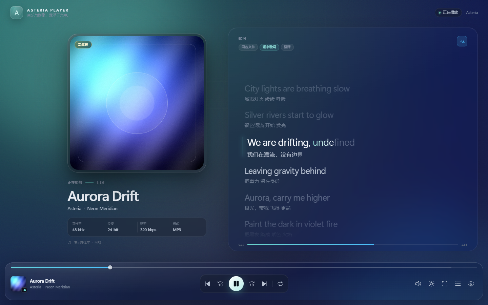
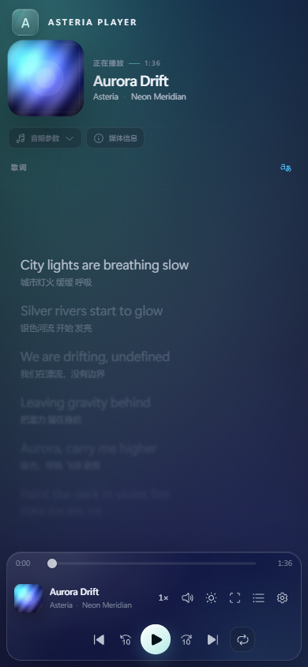
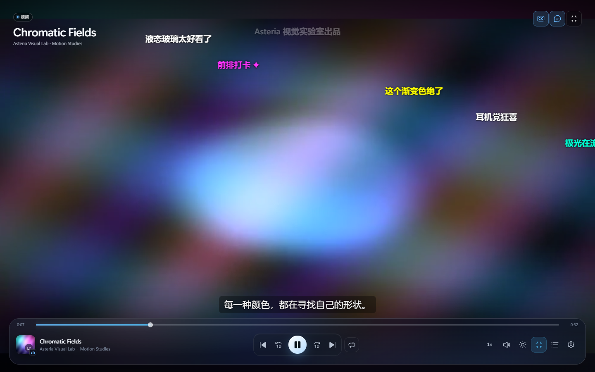

# Asteria Player

一个以 **Microsoft Fluent Design（Sun Valley）** 为视觉基底、融合可选 **Apple Liquid Glass** 悬浮质感的网页音乐 / 视频播放器。底部播放栏、逐字歌词、视频弹幕、字幕、移动端手势、动态背景与 PWA 离线缓存都已落地。





## 当前能力

### 底栏

- 顶沿进度条：细轨、悬停增粗、可拖拽圆形滑块、缓冲区间；当前时长与总时长分别位于轨道两侧。视频条目悬停时显示实时画面缩略图与时间气泡，缩略图会被限制在屏幕内，交互参考 Salt Player for Windows。
- 左侧封面 / 视频缩略图、标题、作者与专辑；点击底栏封面可打开高清大图查看器。
- 中间控制：上一个、快退 10 秒、播放 / 暂停、快进 10 秒、下一个；播放 / 暂停键严格居中，四种播放模式作为独立按钮排列。
- 四种播放模式：单个循环、列表循环、不循环、随机播放。
- 右侧：倍速、音量、亮度、全屏、播放列表、设置；全部为 Fluent UI System Icons。
- 倍速按钮提供 0.5×–3× 常用预设，也支持输入 0.25×–4× 的自定义数值。
- 音量 0–120%，通过 Web Audio `GainNode` 实现 100% 以上增益，并内置五段「调频器」均衡器与预设；音量与亮度卡片同时支持滑块与数值输入。
- 亮度 0–100%，影响封面 / 视频画面，不影响操作层可读性；每项都是独立悬浮卡片。
- 所有播放相关按钮的悬浮提示会显示当前自定义快捷键，例如「全屏 (F)」；修改设置后立即更新。提示使用固定 portal 渲染，可溢出底栏、视频框、播放列表和设置面板，不会被父容器裁切。

### 播放页

- 左侧大封面、标题、作者 / 专辑。封面无外框与角标；点击后可查看大图，支持滚轮 / 双指缩放、双击复位、向下拖动关闭与右上角关闭。
- 采样率、位深、码率等信息默认折叠为「音频参数」按钮，旁边保留独立的「媒体信息」入口。
- 右侧歌词采用接近 Apple Music 的样式：无面板边框、无顶部胶囊、无底部进度条、无当前行左侧竖条；逐字高亮、翻译、自动居中滚动、点击歌词跳转、手动滚动后自动恢复跟随。
- 距当前行越远的歌词逐渐降低透明度并增加模糊，可通过设置关闭模糊；歌词字体、字号、字重、翻译字号均可独立调节。
- 支持 LRC、SPL（Salt Player Lyrics）、增强型 LRC 逐字标记、SPL 行尾标记、延迟逐字标记、翻译配对。
- 支持音频标签内嵌歌词：ID3 `USLT` / `TXXX`、FLAC `LYRICS` / `UNSYNCEDLYRICS`、MP4 `©lyr`。
- 支持同名翻译文件（如 `song.trans.lrc`）与独立字幕、弹幕文件。
- 音频全屏时自动切换为更宽松的双栏布局，封面、歌词与标题同步放大。
- 歌曲属性中的「在线匹配」参考 [LDDC](https://github.com/TonyTown6033/LDDC) 的搜索/候选/应用流程：合并 iTunes（封面与专辑信息）和 LRCLIB（逐行/同步歌词）结果，按标题、艺术家和时长评分。缺少封面的项目会自动展开并开始搜索；已有封面的项目只在用户点击时展开。

### 视频

- 自定义视频层、字幕与 Bilibili 风格弹幕。字幕文件支持 SRT、VTT，按文件名语言后缀自动识别（`movie.zh-CN.srt`、`movie.en.vtt`）。
- **ASS / SSA / XML / JSON 导入时统一作为弹幕文件处理**，不会出现在字幕语言菜单中。多个同名弹幕文件只采用一个，优先级为 **XML > JSON > ASS > SSA**。
- 解析滚动 / 顶部 / 底部三种弹幕模式；设置中可分别开关顶部弹幕与滚动弹幕。弹幕不因顶部标题或按钮而预留区域。
- 窗口播放时左上 / 右上信息只在开始时短暂显示，随后自动隐藏；鼠标移入视频区域时短暂出现。
- 视频全屏后底栏与顶部按钮自动隐藏，鼠标在屏幕任意位置移动都会重新显示，静止后再次隐藏；全屏时始终保留系统光标。
- 手机 / 平板：左侧上滑调亮度、右侧上滑调音量、横滑调进度、长按 2× 倍速、双击播放 / 暂停、单击显示或隐藏底栏；双指快速双击切换弹幕；无操作后自动隐藏。
- 键鼠：单击视频主体播放 / 暂停，双击进入 / 退出全屏；长按方向右键临时 2× 倍速并显示提示，松开恢复。
- 视频右上角提供锁定按钮。锁定后隐藏全部控件、底栏与媒体卡，点击 / 按键只会让锁定按钮显示 3 秒；再次点击锁定按钮解锁。
- 全屏视频可选右上角半透明时间，支持小时:分钟、秒数和日期开关。
- 弹幕可限制在 1/4、半屏、3/4 或全屏范围；活动弹幕达到上限时不再丢弃尚未播完的弹幕。
- 底栏视频选项包含亮度、镜像反转、色觉辅助以及全屏画面尺寸（适应 / 填充 / 拉伸）。
- 手机 / 平板旋转至横屏时自动进入沉浸式全屏视频布局，转回竖屏自动退出。
- 手机 / 平板上使用 16:9 视频卡片 + 媒体信息卡，避免竖屏黑边。
- 文件夹导入时，若视频名为 `P1` / `P2` / `Part 3` / `第4P` 等分 P 名称，或以阿拉伯数字开头（如 `01 开场.mp4`），则用上一级文件夹名作为标题，文件名作为副标题；普通视频不受影响。
- 视频右上角在字幕、弹幕按钮旁提供「视频属性」按钮；属性页内可按标题搜索 B 站视频，并匹配该视频的 XML 弹幕或字幕（字幕会转换为 WebVTT）。B 站接口受跨域限制，可在属性页填写 CORS 代理前缀，格式见下文。

### 播放列表

- 右侧侧边栏，支持一键展开为全页面。
- 左上：条目统计、播放序列切换；默认「全部」，可新建自定义序列。
- 右上：导入、搜索、批量操作、展开 / 收起、关闭。
- 列表内容统一描述为「项目」，同时适用于音乐与视频；不把视频称作曲目。
- 每个项目：封面、标题、作者、时长与三点菜单。
- 三点菜单：从列表移除、下一个播放、加入播放序列、查看详细信息。
- 批量模式：全选、加入序列、移除。
- 列表使用虚拟滚动，可承载大量项目；自定义序列持久化到 `localStorage`。按钮悬浮提示允许超出播放列表窗口，避免被裁切。
- 播放列表顶部提供「自动连播」开关；关闭后媒体结束即停止，不再自动进入下一项。

### 设置

- 主题：深色 / 浅色 / 跟随系统。
- 语言：简体中文 / 繁體中文 / English / 跟随系统，语言包来自外部 JSON；下拉菜单使用 Fluent 自定义列表，支持键盘与选中态。
- 液态玻璃开关：开启后增强折射高光、饱和度与背景模糊。
- 动态背景：根据封面 / 视频缩略图生成柔和的动态环境色；可关闭为静态模糊，并可选择「随 BPM 轻柔律动」与「视频画面跟随视频内容」两个子选项。
- 歌词：字号、翻译字号、字重、字体、是否显示翻译、是否开启远景模糊。
- 视频：字幕语言 / 关闭、字幕背景透明度、字幕文本透明度、字幕字体；弹幕开关、顶部 / 滚动弹幕、弹幕范围、弹幕粗细、大小、透明度、速度、字体；全屏时间及其小时/秒/日期子项；弹幕开源搜索地址。
- 媒体信息：歌曲显示是否有歌词、是否逐字、歌词形式与编码；视频显示是否有字幕、字幕数量与是否有弹幕。
- 快捷键：12 项播放操作均可自定义，支持捕获按键、清空、恢复默认；提示会同步显示在对应按钮的悬浮窗口中。
- 数据与备份：设置以 JSON 保存，可在内置 JSON 编辑器中直接修改当前设置，支持导入/导出文件、复制、填入默认值；默认值来自 `src/config/default-settings.json`。
- 语言包导入：在「外观 → 导入语言包」选择外部 JSON，导入后立即出现在语言下拉并持久化；未翻译的键回退到英文。
- 版本信息与语言包说明。

设置 JSON 与语言包 JSON 的完整格式分别见 [docs/settings-json.md](docs/settings-json.md) 和 [docs/language-pack-json.md](docs/language-pack-json.md)。

### 响应式

针对桌面、平板、手机横竖屏分别调整布局：

- 桌面：三栏底栏 + 左封面 / 右歌词。
- 平板：两行底栏，封面与歌词按宽度收缩；视频横屏自动沉浸。
- 手机：底栏改为三行——进度条、播放控制、六个工具按钮均匀排布；窄屏底栏不显示标题、作者与封面信息。支持视频手势与横竖屏自动全屏。
- 超窄屏（≤ 380px）自动收起亮度入口；播放与列表功能仍可完整使用。
- 横屏矮窗口下自动压缩媒体列，优先保证歌词与播放控制可见。
- 视频全屏与音频全屏使用不同的布局规则：视频隐藏页面装饰，音频保留可读的歌词与底栏。

## 快速开始

要求 Node.js 20+（本项目在 Node 26 上开发）。

```bash
npm install
npm run dev
# http://localhost:4173
```

生产构建与预览：

```bash
npm run build
npm run preview
```

静态站点可直接部署 `dist/`；Vite 使用相对路径 `base: './'`，因此也支持子目录部署。

## GitHub Pages 部署

仓库已包含 [`.github/workflows/deploy.yml`](.github/workflows/deploy.yml)，面向 GitHub Actions + GitHub Pages：

1. 在仓库 **Settings → Pages → Build and deployment** 中把 Source 设为 **GitHub Actions**。
2. 推送到 `main`，或在 Actions 页面手动运行 **Deploy to GitHub Pages**。
3. 工作流会安装依赖、构建、运行测试、上传 `dist/` 并部署。

部署地址通常是 `https://<user>.github.io/<repo>/`。项目使用相对 `base: './'`，已验证在仓库子路径 `/Asteria-Player/` 下资源、manifest、Service Worker scope 与离线缓存均正常；无需修改仓库名或 base。

- Node 版本由 `.nvmrc` 固定为 22，工作流使用 Node 22。
- `dist/.nojekyll` 由工作流生成，避免 GitHub Pages 的 Jekyll 处理。
- 自定义域名不影响相对路径与 PWA。
- 若使用其他静态托管，直接把 `dist/` 上传到站点根目录或子目录即可。

## 使用说明

### 导入媒体

- 点击任一「导入」按钮，选择文件或文件夹；也可以把文件 / 文件夹直接拖入页面。
- 文件夹导入会按文件名自动配对同名资源：

| 资源 | 约定 |
| --- | --- |
| 歌词 | `song.lrc`、`song.spl`、`song.txt`；SPL 优先于 LRC |
| 翻译歌词 | `song.trans.lrc`、`song.translation.lrc`、`song.译文.lrc` |
| 字幕 | `movie.zh-CN.srt`、`movie.en.vtt`（仅 SRT / VTT） |
| 弹幕 | `video.xml`、`video.json`、`video.ass`、`video.ssa`；建议文件名包含 `danmaku` / `弹幕` |
| 封面 | 同名 `.jpg` / `.png` / `.webp`；音频标签内嵌封面优先 |

ASS / SSA / XML 导入后一律进入弹幕层，不会出现在字幕语言选项里。多个同名弹幕文件只采用一个，优先 XML，其次 JSON、ASS、SSA。

分 P 视频约定：文件夹 `My Show/P1.mp4` 会显示标题 `My Show`、副标题 `P1`；`P2 片头.mp4` 同理。

### 歌词规范

SPL 语法按 [Salt Player Lyrics 标准](https://moriafly.com/standards/spl.html) 实现，兼容增强型 LRC：

```text
[00:09.20]City <00:09.55>lights <00:09.95>are <00:10.25>breathing <00:10.85>slow[00:13.20]
[00:09.20]城市<00:09.55>灯火 <00:09.95>缓缓 <00:10.25>呼吸[00:13.20]
```

- 相同时间戳的后续行视为翻译。
- 无时间戳、紧跟主歌词的纯文本行也视为翻译（SPL 规则）。
- 仅含时间戳的行是显式结束标记，不生成歌词行。
- 支持 `[offset:500]`。
- 自动忽略 LX Music `[awlrc:...]` 兼容字段。

### 设置 JSON 与语言包

- 设置默认值文件：`src/config/default-settings.json`
- 当前默认视觉：动态背景开、BPM 律动开、视频画面跟随关；歌词 110% / 700 字重 / 翻译 70%；弹幕大小 25px
- 当前设置：**设置 → 数据与备份 → 打开 JSON 编辑器**
- 导入/导出使用 `{ "version": 1, "settings": { ... } }` 文档结构；也接受裸设置对象
- 语言包导入：**设置 → 外观 → 导入语言包**
- 格式说明：[设置 JSON](docs/settings-json.md) · [语言包 JSON](docs/language-pack-json.md)

### 在线匹配

- 歌曲：打开歌曲属性（媒体信息），缺少封面时自动打开在线匹配；已有封面时点击「在线匹配」。结果来自 iTunes Search 与 LRCLIB，可选择候选并一次性应用封面、歌词和元数据。
- 视频：打开视频属性，输入标题搜索 B 站；结果可分别匹配弹幕或字幕。B 站 API 通常拒绝跨域请求，属性页提供代理输入框，示例 `https://your-proxy.example/?url={url}`（`{url}` 会替换为编码后的目标地址）。
- 推荐使用开源自部署弹幕聚合服务 [danmu_api](https://github.com/huangxd-/danmu_api)（AGPL-3.0）：在视频属性填入其根地址（含 token，如 `https://danmu.example/87654321`）后，搜索和弹幕匹配会走该开源服务；B 站字幕仍需直连或 CORS 代理。

### 快捷键

快捷键可在 **设置 → 快捷键** 中逐项修改；所有修改会立即反映到对应按钮的悬浮提示中。

| 默认按键 | 功能 |
| --- | --- |
| `Space` | 播放 / 暂停 |
| `Alt` + `←` / `→` | 上一个 / 下一个项目 |
| `←` / `→` | 快退 / 快进 5 秒 |
| `Shift` + `←` / `→` | 快退 / 快进 30 秒 |
| `J` / `L` | 快退 / 快进 10 秒 |
| `R` | 切换播放模式 |
| `M` | 静音 / 取消静音 |
| `F` | 全屏 |
| `Q` | 打开 / 关闭播放列表 |
| `S` | 打开 / 关闭设置 |
| `Esc` | 关闭当前浮层 / 退出伪全屏 |

## 外部语言包

语言包位于 `public/locales/`，完全由运行时 `fetch` 加载，不参与打包：

```json
{
  "languages": [
    { "code": "zh-CN", "label": "简体中文", "nativeLabel": "简体中文", "file": "zh-CN.json" },
    { "code": "zh-TW", "label": "繁體中文", "nativeLabel": "繁體中文", "file": "zh-TW.json" },
    { "code": "en", "label": "English", "nativeLabel": "English", "file": "en.json" }
  ]
}
```

新增语言：

1. 复制一份 JSON，翻译其中的扁平键（如 `player.play`、`settings.theme`）。
2. 在 `manifest.json` 中追加条目。
3. 刷新页面，设置中的语言下拉会自动出现新选项。

「跟随系统」会根据 `navigator.languages` 匹配语言包，并正确处理 `zh-Hans` / `zh-Hant`、`en-US` 等区域变体。

也可以在 **设置 → 外观 → 导入语言包** 中直接导入上述格式的 JSON；导入包保存在 `localStorage`，无需重新构建。未翻译的键会回退到英文。完整格式见 [docs/language-pack-json.md](docs/language-pack-json.md)。

## PWA 与缓存

- `public/manifest.webmanifest` 提供安装信息、主题色与 192 / 512 图标。
- 生产构建会生成 `sw-assets.json` 预缓存清单，并把资源哈希写入 `sw.js` 的缓存版本；新部署会安装新 Service Worker 并清理旧缓存。
- 导航请求采用 **network-first**：每次访问都会尝试获取最新页面，失败时回退到本地缓存。
- 静态资源采用 **stale-while-revalidate**：先返回缓存，同时在后台更新；音频 / 视频等大文件与 Range 请求不进入缓存。
- Service Worker 仅在 `npm run build` 的产物中注册；开发模式不会干扰 HMR。
- 注册后会立即 `update()`，并在页面重新可见时再次检查更新。

## 设计与实现

### 视觉

- Fluent 设计令牌：Mica 式多层半透明、8–26px 圆角、Fluent 动效曲线、Segoe UI Variable 字体栈。
- Sun Valley 深 / 浅色双主题，`data-theme` 在首屏渲染前应用，避免闪烁。
- 可选的 Liquid Glass：**设置 → 外观 → 液态玻璃**，开启后增加高光、折射边框与更强背景模糊。
- 所有功能图标来自 [`@fluentui/react-icons`](https://github.com/microsoft/fluentui-system-icons)。

### 模块拆分

```text
src/
├─ App.tsx                     # 应用装配、拖放、全屏与外观副作用
├─ config/
│  └─ default-settings.json    # 默认设置单一来源
├─ components/
│  ├─ chrome/                  # 底栏、进度条、传输控制、工具入口
│  ├─ common/                  # 图标按钮、滑块、开关、分段控件、下拉、数值输入、菜单、弹层
│  ├─ nowplaying/              # 封面 / 技术参数 / 大图查看、歌词视图
│  ├─ queue/                   # 侧边栏 / 全页队列、虚拟列表、批量操作
│  ├─ settings/                # 外观 / 歌词 / 视频 / 快捷键 / 数据分组，JSON 编辑器
│  ├─ video/                   # 视频层、字幕、弹幕
│  └─ overlays/                # 详情、歌曲/B站在线匹配、新建序列、Toast、拖放提示
├─ hooks/                      # 主题、全屏、自动隐藏、触摸手势、横竖屏、快捷键、外部关闭
├─ i18n/                       # 外部语言包加载
├─ lib/
│  ├─ lyrics.ts                # LRC / SPL / 翻译 / 逐字
│  ├─ subtitles.ts             # SRT / VTT 解析与语言识别
│  ├─ danmaku.ts               # XML / JSON / ASS 弹幕解析
│  ├─ shortcuts.ts             # 快捷键动作、格式化、匹配与默认值
│  ├─ settingsJson.ts          # 默认设置、JSON 校验/导入导出
│  ├─ languagePacks.ts         # 外部语言包解析、校验与持久化
│  ├─ onlineMatch.ts           # iTunes / LRCLIB 搜索与候选合并
│  ├─ bilibili.ts              # B 站搜索、danmu_api 聚合、弹幕、字幕与分 P
│  ├─ fonts.ts                 # 歌词 / 字幕 / 弹幕字体栈
│  ├─ metadata/                # ID3 / FLAC / MP4 / WAV 标签读取
│  ├─ importer.ts              # 文件分组、同名资源配对、元数据
│  └─ media.ts                 # 歌词 / 字幕 / 弹幕解析缓存
├─ player/
│  ├─ engine.ts                # 双媒体元素 + Web Audio 图 + 播放状态机
│  └─ ImportProvider.tsx       # 文件选择器与导入流程
├─ state/                      # Zustand：library / playback / clock / settings / ui
└─ styles/                     # 令牌、基础、底栏、播放页、视频、队列、设置、响应式

public/
├─ sw.js                       # 生产 Service Worker（导航 network-first，资源 SWR）
└─ manifest.webmanifest        # PWA 安装信息
```

### 性能设计

- **时钟与界面解耦**：播放进度只写入独立 `clock` store，约 20Hz 更新；底栏、歌词、字幕按需订阅，不触发整页重渲染。
- **虚拟列表**：队列使用 `@tanstack/react-virtual`，只渲染视口附近的行。
- **按需加载**：设置面板与队列面板通过 `React.lazy` 拆分为独立 chunk。
- **解析缓存**：歌词 / 字幕 / 弹幕按项目缓存，拖动进度条不会重复解析文件。
- **歌词 memo**：非当前行不随时间重渲染，只更新活动行与相邻行。
- **媒体元素复用**：音频 / 视频各一个元素，切换曲目时复用 Web Audio 图与媒体源。
- **静态优先的缓存策略**：生产环境用 Service Worker 预缓存应用外壳，导航网络优先、资源后台刷新，提升二次访问速度。
- **CSS 自适应**：液态玻璃可关闭，移动端减少模糊半径；`prefers-reduced-motion` 自动降级动画。
- **动态背景限频**：视频画面仅约 1Hz 采样到 80×45 画布，避免逐帧绘制造成主线程压力。

## 演示媒体

`public/demo/` 中的音频、封面、视频、歌词、字幕、弹幕全部由代码合成，不含第三方版权素材：

```bash
python scripts/generate-demo.py
```

需要 `numpy`、`Pillow`、`ffmpeg`、`mutagen`。该脚本会重新生成：

- 3 首 48kHz / 44.1kHz 音乐（MP3 / FLAC，含内嵌封面与 ID3/FLAC 标签歌词）
- 1 个 960×540 抽象视频（带音轨）
- SPL 逐字歌词 + 翻译、LRC 翻译歌词
- 中文 / 英文 / 日文字幕
- Bilibili XML 弹幕

## 验证

```bash
npm test        # 46 个解析器 / 设置 / 在线匹配 / B 站单元测试
npm run qa       # 桌面端到端交互检查（需要本机 Edge 与运行中的 dev server）
npm run qa:touch # 手机触摸手势、横竖屏与视频自动隐藏检查
npm run shots    # 输出桌面 / 平板 / 手机 / 视频 / 全屏截图
```

`npm run qa` 与 `npm run shots` 默认使用 Windows Edge 路径；可通过 `EDGE_PATH` 环境变量覆盖。

## 已知限制

- 本地导入的媒体保存在当前页面会话中（`File` + `blob:` URL），刷新后不会保留；演示媒体库与自定义序列会保留。
- 可播放格式取决于浏览器编解码器（Chrome / Edge 对 MKV、部分 AVI 支持有限）。
- 120% 音量依赖 Web Audio；跨域且未返回 CORS 头的远程媒体会回退到浏览器原生的 0–100% 音量。
- 弹幕使用简化泳道，不做完整的碰撞检测与密度限制。
- ASS / SSA 仅解析对白作为弹幕文本，不还原完整 ASS 定位、特效与样式。
- SPL 的 `awlrc` 字段按规范忽略；SYLT 帧不做解析，优先 `USLT`。
- iOS Safari 的标准 Fullscreen API 对普通元素支持有限，播放器会回退到页面内「伪全屏」；旋转自动全屏同样使用伪全屏，以避开浏览器手势限制。
- 离线缓存包含应用外壳与图片 / 语言包，不包含体积较大的音频 / 视频文件。
- B 站接口没有稳定的公开 CORS 头；静态部署时应配置自己的代理，或使用允许跨域的代理服务。
- 在线匹配结果来自第三方公共目录，网络、区域和版权可用性会影响返回结果；应用前请确认候选内容。
- 语言包导入仅保存字符串字典，不执行脚本；部分语言包缺失的键回退到英文。

## License

GPL-3.0，见 [LICENSE](LICENSE)。
